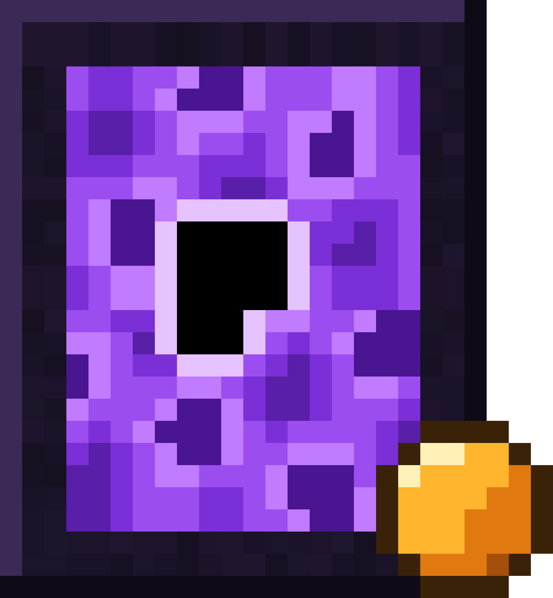

<h1 align="center">Autyism's Easy Suppressions</h1>

Minecraft Java 1.21.11 · Fabric · server + client 
<a href="#中文">中文</a> · <a href="#english">English</a>

---

## 中文

1.21.11 里想切传送门、想做光照抑制，基本都要靠 Carpet 的 CCE 大型更新抑制器。那套东西又大又容易翻车（崩服、坏档、刷物品）。这个模组只做大家真正想要的那两个**效果**，完全不碰真正的更新抑制：

- **切门方块**：通红石时，区域里的下界传送门不会因为方块更新碎掉，可以用**传送门挖掘镐**一格一格地挖，挖出任意形状。断电后恢复原版规则。
- **光抑方块**：锁定后，游戏在区域里查询光照时直接得到设定值（锁定当时的真实值，或固定为 0~15）。刷怪判定、作物、冰雪融化、阳光探测器、亡灵燃烧……全部按设定值算。光照引擎和光照数据本身一点不改。

服务端和客户端都要装。没装的客户端进服时会看到一句清楚的提示，不会莫名其妙地断开。

### 内容

| 名称 | 说明 |
|---|---|
| 切门方块 | 有红石信号时生效，区域内的传送门对方块更新免疫 |
| 光抑方块 | 锁定后生效，红石信号只决定能不能打开界面 |
| 切门选区器 / 光抑选区器 | 左键设点 1，右键设点 2（准星 64 格内的方块），手持时显示选区框 |
| 传送门挖掘镐 | 只能挖下界传送门，一次一格；在生效的切门区域里只挖这一格，区域外整扇门按原版碎掉 |

两种方块的共同点：

- 只有玩家能拆，生存模式固定 10 秒（可调），不受工具、效率、急迫、挖掘疲劳、水里、空中等任何因素影响；拆了**不掉落**（精准采集也一样）。
- 爆炸、凋灵、末影龙都破坏不了；活塞推不动也拉不动。
- 可以被任何常规红石方式充能，但**只进不出**：不导电，比较器读不出东西；激活状态存在方块实体里，侦测器完全没反应。
- 激活时会换成发光的动画贴图（贴图带 LabPBR 法线和高光，开光影更好看）。

### 配方

切门方块：黑曜石 / 下界之星 / 黑曜石，下界之星 / **紫水晶块** / 下界之星，黑曜石 / 下界之星 / 黑曜石
光抑方块：同上，中间换成**萤石块**
选区器：竖着三个对应的方块
传送门挖掘镐：镐子形状，三个切门方块 + 两根木棍

### 怎么用

1. 拿选区器框出区域（左键一个角、右键另一个角）。
2. 设定方块的区域，三种办法任选：
   - **铁砧**：左边放方块，右边放选区器，消耗 1 级，选区器不消耗；
   - 方块界面里点**“导入手持选区器的选区”**；
   - 在界面里直接**输入两个角的坐标**。
   区域必须包含方块本身，大小没有上限。
3. **切门**：给方块红石信号就生效，建议建好后一直供电。然后拿传送门挖掘镐慢慢挖就行。
4. **光抑**：通红石打开界面，两个通道（天空光 / 方块光）各自选“不干预 / 锁定当前 / 固定为 N”，或者直接点预设：**简单模式**、**刷怪平台**（全 0）、**防刷怪**（方块光 15）、**只抑天空光**。点“锁定”确认后永久生效，断电也不影响，直到解除或者方块被拆掉。
   - “锁定当前”会逐格精确记录；当时没加载的区块会在第一次加载时补记，界面里能看到还剩多少，世界里会用红色柱子标出来。
   - 光抑区域之间不能重叠。
   - 画面可以按设定值显示（区域看起来变暗/变亮），也可以显示真实光照，每个人自己选。

### 设置和命令

- 设置文件 `config/easysuppressions.json`：方块破坏时间（默认 10 秒）、挖掘镐挖传送门的时间（默认 1 秒）。以服务端为准，会同步给所有人。
- 装了 Mod Menu 可以在游戏里改：单人直接改；服务器上 OP 可以改，其他人只能看。
- `/easysuppressions zones list`：列出所有生效中的区域（OP）。
- `/easysuppressions config blockBreakSeconds <秒>` / `portalPickaxeSeconds <秒>`：命令行改设置（OP）。

### 兼容性

在 1.21.11 + Fabric Loader 0.19.5 + Fabric API 0.141.6 上测试过，服务端一起装了 Carpet（含 TIS / Gugle / Crystal 附加包）、Lithium、C2ME、VMP、Krypton、FerriteCore、Servux、Syncmatica、Voxy 等；客户端测过 Sodium 和 Iris。

### 许可证

GPL-3.0-only

---

## English

On 1.21.11, cutting nether portals or suppressing light usually means building a big Carpet CCE update suppressor — which is large, fragile and can crash the server, corrupt the world or dupe items. This mod gives you only the **effects** people actually want, without any real update suppression:

- **Portal Cutter Block**: while powered, nether portal blocks inside its zone ignore block updates, so you can carve them one block at a time with the **Portal Pickaxe**, into any shape. Without power, vanilla rules apply again.
- **Light Suppressor Block**: once locked, every light query inside its zone returns the value you set (the real value at the moment of locking, or a fixed 0–15). Mob spawning, crops, ice melting, daylight detectors, burning undead… all see the set value. The light engine and light data are never touched.

Needed on both server and client. A client without the mod gets a clear message when it tries to join instead of a confusing disconnect.

### Content

| Name | What it does |
|---|---|
| Portal Cutter Block | Active while powered by redstone; portal blocks in its zone are immune to block updates |
| Light Suppressor Block | Active once locked; redstone only decides whether its GUI can be opened |
| Portal Cutter Selector / Light Suppressor Selector | Left click = corner 1, right click = corner 2 (any block within 64 blocks); shows the box while held |
| Portal Pickaxe | Mines nether portal blocks only, one at a time. Inside an active cutter zone only that block goes; elsewhere the whole portal breaks the vanilla way |

Both blocks:

- Only players can break them. Survival break time is a fixed 10 s (configurable), not affected by tools, Efficiency, Haste, Mining Fatigue, water or being airborne. They **drop nothing**, Silk Touch included.
- Explosions, withers and the ender dragon cannot destroy them; pistons cannot push or pull them.
- Any normal redstone source powers them, but power only goes **in**: they do not conduct and comparators read nothing. The active state lives in the block entity, so observers never notice it.
- When active they switch to an animated, glowing texture (with LabPBR normal and specular maps for shader packs).

### Recipes

Portal Cutter Block: obsidian / nether star / obsidian, nether star / **amethyst block** / nether star, obsidian / nether star / obsidian
Light Suppressor Block: the same with a **glowstone block** in the middle
Selectors: three of the matching block in a column
Portal Pickaxe: pickaxe shape, three Portal Cutter Blocks and two sticks

### How to use

1. Select the zone with a selector (left click one corner, right click the other).
2. Give the block its zone, in any of three ways:
   - **anvil**: block on the left, selector on the right, 1 level, the selector is kept;
   - **"Import held selector"** in the block's GUI;
   - type the two corners into the GUI.
   The zone must contain the block itself; there is no size limit.
3. **Portal cutter**: power the block and it works. Keep it powered once the build is done, then carve the portal with the Portal Pickaxe.
4. **Light suppressor**: power it to open the GUI. Pick a mode for each channel (sky light / block light): "Untouched", "Lock current" or "Fixed N", or use a preset: **Simple mode**, **Mob farm** (both 0), **No spawning** (block light 15), **Sky light only**. Lock (with confirmation) and it stays in effect, with or without redstone, until you unlock it or the block is removed.
   - "Lock current" records every block exactly. Chunks that were not loaded are recorded the first time they load; the GUI shows how many are left and the world marks them with red pillars.
   - Light suppressor zones may not overlap.
   - Each player chooses whether the zone is drawn with the set light (looks darker / brighter) or the real light.

### Settings and commands

- `config/easysuppressions.json`: block break time (default 10 s) and Portal Pickaxe mining time (default 1 s). The server's values count and are sent to everyone.
- With Mod Menu you can change them in game: directly in singleplayer; operators on a server; other players see them read-only.
- `/easysuppressions zones list`: every active zone (operators).
- `/easysuppressions config blockBreakSeconds <s>` / `portalPickaxeSeconds <s>` (operators).

### Compatibility

Tested on 1.21.11, Fabric Loader 0.19.5 and Fabric API 0.141.6, with Carpet (plus the TIS, Gugle and Crystal addons), Lithium, C2ME, VMP, Krypton, FerriteCore, Servux, Syncmatica and Voxy on the server, and Sodium and Iris on the client.

### License

GPL-3.0-only
